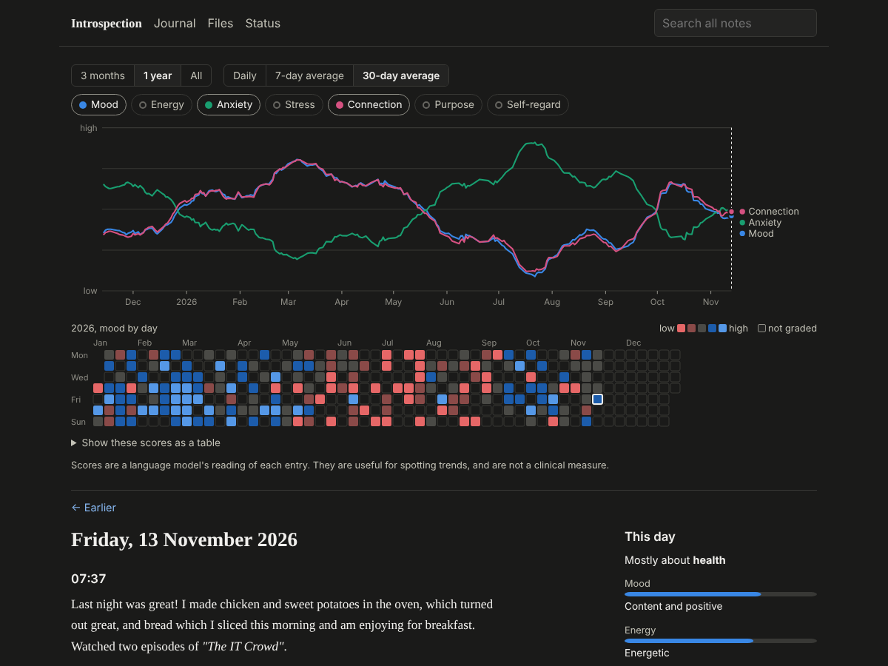

#+title: Journal Introspection

A small private web app for reading a directory of org-mode files, with a
timeline that charts journal entries graded by a local [[https://github.com/jaredpalmer/kev][Kev]] model.

One Go binary, one SQLite file, about 14 MB as a container. The org files
are mounted read-only and are never written to. The design and the build
plan are in [[file:docs/DESIGN.md][docs/DESIGN.md]].

* Try it locally

No Mac mini needed: =fakekev= is a stand-in that returns keyword-based
scores so the timeline has something to draw. Its scores mean nothing.

#+begin_src bash
go run ./cmd/fakekev &
ORG_ROOT=~/SyncRoot/org DATA_DIR=./data AUTH_DISABLED=1 \
  KEV_URL=http://127.0.0.1:8009 ADDR=127.0.0.1:8080 go run ./cmd/introspect
#+end_src

Then open http://127.0.0.1:8080. Delete =./data= afterwards so the fake
scores do not linger (real grades are stored under the real model's name,
so they would not mix, but there is no reason to keep them).

* Deploy

1. Copy =.env.example= to =.env=. Set =ORG_DIR= and =SITE_ADDRESS=.
2. Make the login settings and paste both lines into =.env=:
   #+begin_src bash
   docker compose run --rm introspect hash-password
   #+end_src
   Add the TOTP secret to an authenticator app.
3. Start it:
   #+begin_src bash
   docker compose up -d --build
   #+end_src

Caddy fetches the TLS certificate. The =Caddyfile= has a commented-out
=basic_auth= block; turning it on gives a second lock in front of the app.

* Kev on the Mac mini

Kev is its own Python server, not an Ollama model.

#+begin_src bash
git clone https://github.com/jaredpalmer/kev.git && cd kev
uv sync --extra serve
uv run --extra serve python -m kev.serve --run jaredpalmer/kev-4b --port 8009
#+end_src

Use =jaredpalmer/kev-0.8b= if the Mac has less than 32 GB of memory. Set
=KEV_URL= to an address the container can reach (LAN or Tailscale). Do not
expose port 8009 to the internet. If Kev is off, the reader still works
and grading resumes when it comes back.

* Settings

| Variable             | Default        | Meaning                                              |
|----------------------+----------------+------------------------------------------------------|
| =ORG_ROOT=           | =/org=         | Directory of org files                               |
| =DATA_DIR=           | =/data=        | Where =introspect.db= lives                          |
| =ADDR=               | =:8080=        | Listen address                                       |
| =SCAN_INTERVAL=      | =2m=           | How often to look for changed files                  |
| =EXCLUDE=            | see =.env.example= | Comma-separated globs never indexed or served    |
| =KEV_URL=            | empty          | Kev server; empty turns grading off                  |
| =KEV_MODEL=          | =kev-latest=   | Model name, stored with every grade                  |
| =RUBRIC=             | built in       | Path to your own =rubric.json=                       |
| =AUTH_PASSWORD_HASH= | required       | From =introspect hash-password=                      |
| =AUTH_TOTP_SECRET=   | empty          | Base32 secret; empty means password only             |
| =AUTH_DISABLED=      | off            | =1= removes the login (private networks only)        |
| =TRUST_PROXY=        | off            | =1= reads the client address from =X-Forwarded-For=  |
| =COOKIE_INSECURE=    | off            | =1= allows the session cookie over plain http        |

* The rubric

The questions asked about every entry are in
[[file:internal/grader/rubric.json][internal/grader/rubric.json]]. Each one is a Kev question with written
levels. Editing the file (or pointing =RUBRIC= at your own copy) changes
the rubric version, and every entry is graded again in the background.
Old grades are kept.

* Development

#+begin_src bash
go test ./...
#+end_src

| Path                | What it does                                            |
|---------------------+---------------------------------------------------------|
| =cmd/introspect=    | The program: =serve=, =hash-password=, =healthcheck=    |
| =cmd/fakekev=       | Stand-in Kev server for development                     |
| =internal/indexer=  | Walks the tree, detects changes, splits journal entries |
| =internal/grader=   | Rubric, Kev client, background grading                  |
| =internal/web=      | Pages, login, the SVG timeline                          |
| =internal/store=    | SQLite schema                                           |
| =testdata/org=      | A small fake org tree used by the tests                 |

* What it looks like

These use generated sample entries and the stand-in grader, not real data.

[[file:docs/screenshots/home-light.png]]

