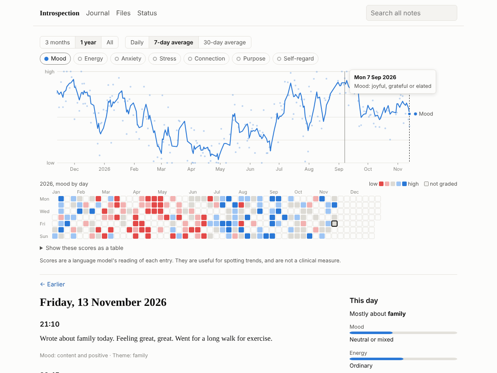

#+title: Journal Introspection

A small private web app for reading a directory of org-mode files, with a
timeline that charts journal entries graded by a local [[https://github.com/jaredpalmer/kev][Kev]] model.

One Go binary, one SQLite file, about 14 MB as a container. The org files
are mounted read-only and are never written to. How it works and why is in
[[file:docs/DESIGN.md][docs/DESIGN.md]].

(Made-up entries and a stand-in grader, not real data.)

* Try it locally

Needs Go 1.26 or newer. No model server, login or Docker involved.

#+begin_src bash
make dev
#+end_src

Open http://127.0.0.1:8080. This writes a made-up journal to =.dev/org= and
starts =fakekev=, a stand-in grader whose scores are keyword counts and mean
nothing.

To read your real files the same way (still read-only, still fake scores):

#+begin_src bash
make dev ORG=~/org
#+end_src

=make local= runs the same thing in Docker, to check the container.
=make test= runs the tests. =make clean= removes =.dev=.

* Deploy on the home server

1. Copy =.env.example= to =.env=. Set =ORG_DIR= (the synced org folder),
   =SITE_ADDRESS= and =KEV_URL=. Review =EXCLUDE=.
2. Make the login settings, and paste the two lines it prints into =.env=:
   #+begin_src bash
   make hash
   #+end_src
   Add the secret to an authenticator app.
3. Start it:
   #+begin_src bash
   make up
   #+end_src

Caddy fetches the TLS certificate, so ports 80 and 443 must reach the
server. The =Caddyfile= has a commented-out =basic_auth= block; turning it
on puts a second lock in front of the app's own login.

To update: =git pull && make up=. The database is in the =data= volume and
only holds things derived from the org files, plus grades and sessions.

* Kev on the model server

Kev is its own Python server, not an Ollama model. It runs on a separate
machine on the network. On a machine with 16 GB of memory, use the 0.8B
model (the 4B model wants 32 GB).

#+begin_src bash
git clone https://github.com/jaredpalmer/kev.git && cd kev
uv sync --extra serve
uv run --extra serve python -m kev.serve --run jaredpalmer/kev-0.8b --port 8009
#+end_src

Then set =KEV_URL= to that machine's LAN address. Keep port 8009 off the
internet. If that machine is off, the reader still works and grading resumes
when it is back.

To change models later, start Kev with the other model and change
=GRADE_LABEL=. Every entry is graded again in the background and the old
grades are kept. Any server that answers =POST /v1/systemone= the way Kev
does will work.

* Settings

All settings are environment variables; in Docker they go in =.env=.

| Variable             | Default      | Meaning                                                   |
|----------------------+--------------+-----------------------------------------------------------|
| =ORG_ROOT=           | =/org=       | Directory of org files (=ORG_DIR= in =.env= is mounted here) |
| =DATA_DIR=           | =/data=      | Where =introspect.db= lives                               |
| =ADDR=               | =:8080=      | Listen address                                            |
| =SCAN_INTERVAL=      | =2m=         | How often to look for changed files                       |
| =EXCLUDE=            | see below    | Files that are never indexed, listed, searched or served  |
| =KEV_URL=            | empty        | Kev server; empty turns grading off                       |
| =KEV_MODEL=          | =kev-latest= | Model name sent to Kev                                    |
| =GRADE_LABEL=        | =KEV_MODEL=  | Name grades are stored under; change it to regrade        |
| =RUBRIC=             | built in     | Path to your own =rubric.json=                            |
| =AUTH_PASSWORD_HASH= | required     | From =make hash=                                          |
| =AUTH_TOTP_SECRET=   | empty        | Authenticator secret; empty means password only           |
| =AUTH_DISABLED=      | off          | =1= removes the login (private networks only)             |
| =TRUST_PROXY=        | off          | =1= reads the client address from =X-Forwarded-For=       |
| =COOKIE_INSECURE=    | off          | =1= allows the session cookie over plain http             |

** EXCLUDE

A comma-separated list of globs, relative to the org directory. A pattern
is matched against the whole path and against the file name, and =dir/**=
covers a directory and everything in it. Setting =EXCLUDE= replaces the
built-in list, which is:

#+begin_example
private/**,secret*.org,*.gpg
#+end_example

Hidden files and directories are always skipped. The status page shows the
list in use. Put your own private files in =EXCLUDE= in =.env=, which is
not committed. A newly excluded file leaves the index on the next scan.

* The rubric

The questions asked about every entry are in
[[file:internal/grader/rubric.json][internal/grader/rubric.json]]. Each is a Kev question with written levels.
Editing the file and rebuilding, or pointing =RUBRIC= at your own copy,
changes the rubric version, and every entry is graded again.

* Code

| Path               | What it does                                            |
|--------------------+---------------------------------------------------------|
| =cmd/introspect=   | The program: =serve=, =hash-password=, =healthcheck=    |
| =cmd/fakekev=      | Stand-in Kev server for development                     |
| =cmd/sample=       | Writes a made-up journal for =make dev=                 |
| =internal/config=  | Settings                                                |
| =internal/store=   | SQLite schema                                           |
| =internal/indexer= | Walks the tree, detects changes, splits journal entries |
| =internal/grader=  | Rubric, Kev client, background grading                  |
| =internal/web=     | Pages, login, the SVG timeline                          |
| =testdata/org=     | A small fake org tree used by the tests                 |
